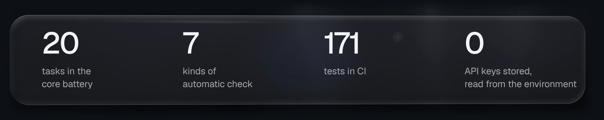
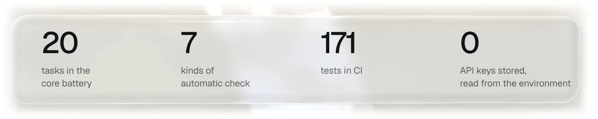
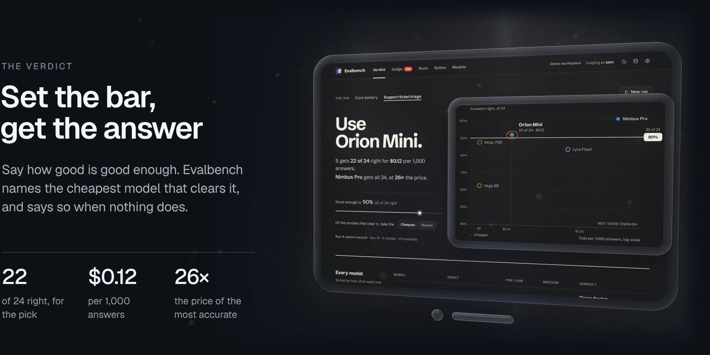
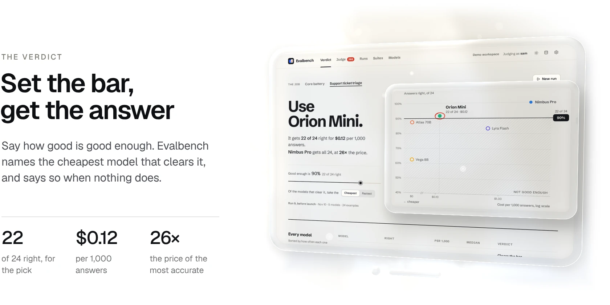
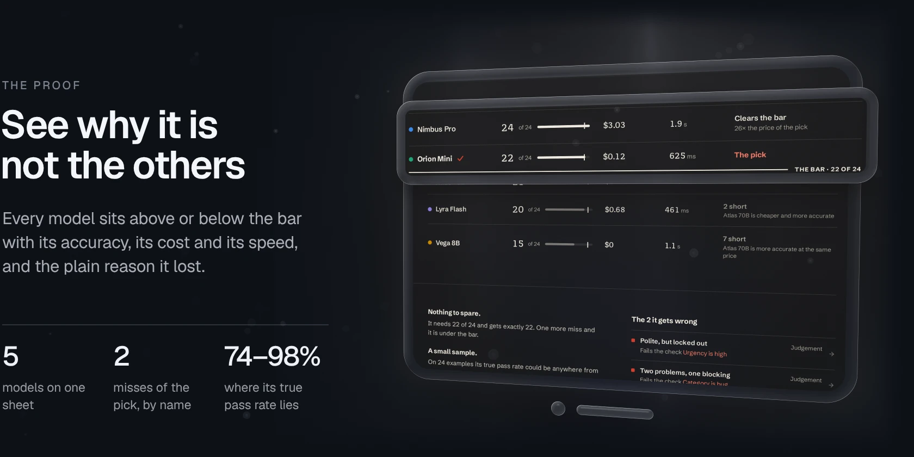
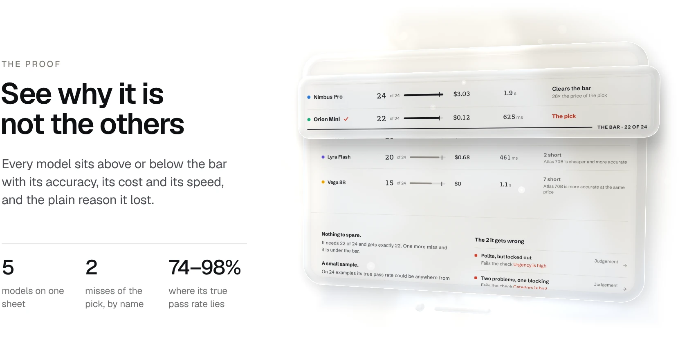
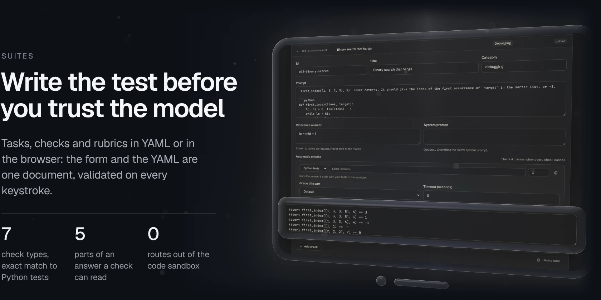
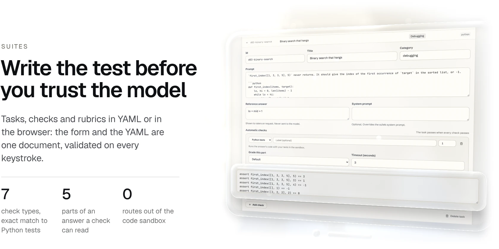
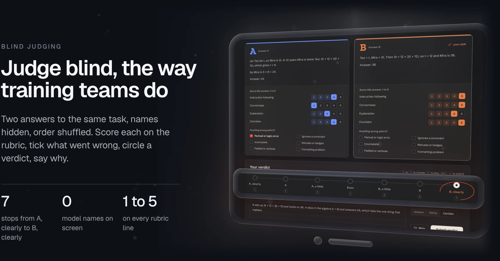
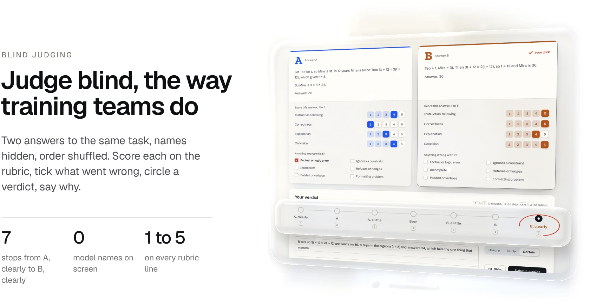

<a href="https://gallowforge.github.io/evalbench/#gh-dark-mode-only"><picture><source media="(max-width: 767px)" srcset="docs/readme/hero-dark-phone.webp 2.835x"><source srcset="docs/readme/hero-dark.webp 2x"></picture></a><a href="https://gallowforge.github.io/evalbench/#gh-light-mode-only"><picture><source media="(max-width: 767px)" srcset="docs/readme/hero-light-phone.webp 2.835x"><source srcset="docs/readme/hero-light.webp 2x"></picture></a>

A leaderboard tells you which model is best at someone else's tasks. A few chats tell you which one sounds best. Neither tells you which model to put behind the job you actually have, or what a cheaper one would cost you in mistakes. **Evalbench answers that for your own job.** Write down what a good answer is, run the models you are considering, and it names the one to use: the cheapest model that clears your bar, with every number behind the pick on the page. When nothing clears the bar, it says that instead. It runs local models in LM Studio or Ollama and API models from Anthropic and OpenAI, starts from one compose file, keeps everything in one SQLite file, and never stores an API key.

<p align="center"><a href="https://gallowforge.github.io/evalbench/"><b>Try the demo</b></a> &nbsp;·&nbsp; <a href="#quickstart">Quickstart</a> &nbsp;·&nbsp; <a href="#how-it-works">How it works</a> &nbsp;·&nbsp; <a href="https://github.com/gallowforge/evalbench/releases">Releases</a></p>

<a href="evalbench/data/suites/support-triage.yaml#gh-dark-mode-only"><picture><source media="(max-width: 767px)" srcset="docs/readme/numbers-dark-phone.webp 2.835x"><source srcset="docs/readme/numbers-dark.webp 2x"></picture></a><a href="evalbench/data/suites/support-triage.yaml#gh-light-mode-only"><picture><source media="(max-width: 767px)" srcset="docs/readme/numbers-light-phone.webp 2.835x"><source srcset="docs/readme/numbers-light.webp 2x"></picture></a>

<a href="evalbench/verdict.py#gh-dark-mode-only"><picture><source media="(max-width: 767px)" srcset="docs/readme/verdict-dark-phone.webp 2.835x"><source srcset="docs/readme/verdict-dark.webp 2x"></picture></a><a href="evalbench/verdict.py#gh-light-mode-only"><picture><source media="(max-width: 767px)" srcset="docs/readme/verdict-light-phone.webp 2.835x"><source srcset="docs/readme/verdict-light.webp 2x"></picture></a>

The bar is the share of examples a model must get right. Of the models that clear it, the pick is the cheapest, or the fastest if you ask for that. In the demo's support triage job the bar is 90%: Orion Mini gets 22 of 24 right for $0.12 per 1,000 answers, and Nimbus Pro gets all 24 at 26× the price. Drag the bar to 80% and the answer becomes Atlas 70B, a local model with no API bill. Drag it to 95% and only Nimbus Pro is left. On the core battery at 95% nothing clears it, and the page says so: **No model is good enough yet**, then the closest model and how far short it is.

The rule is small on purpose. Every number it uses is on the page, so the pick can be checked by hand, and cost is worked out from the tokens the run really used at the prices you set.

<a href="web/src/pages/Verdict.tsx#gh-dark-mode-only"><picture><source media="(max-width: 767px)" srcset="docs/readme/proof-dark-phone.webp 2.835x"><source srcset="docs/readme/proof-dark.webp 2x"></picture></a><a href="web/src/pages/Verdict.tsx#gh-light-mode-only"><picture><source media="(max-width: 767px)" srcset="docs/readme/proof-light-phone.webp 2.835x"><source srcset="docs/readme/proof-light.webp 2x"></picture></a>

- **Every model, one line each.** How many it got right, what 1,000 answers cost, its median latency, and where it stands: the pick, clears the bar, or how many short. A model that another one beats says so in words: `Atlas 70B is cheaper and more accurate`.
- **Before you ship it.** The pick's margin (`It needs 22 of 24 and gets exactly 22`), the range its true pass rate could lie in on a sample this size (74% to 98% on 24 examples), what a million answers would cost ($116, against $3,032 for the most accurate model), and the examples it gets wrong, by name, with the check each one fails.
- **Task by task.** One square per example and model, red for a miss. Each square opens that example with every model's answer in columns.

<a href="examples/suite-template.yaml#gh-dark-mode-only"><picture><source media="(max-width: 767px)" srcset="docs/readme/write-dark-phone.webp 2.835x"><source srcset="docs/readme/write-dark.webp 2x"></picture></a><a href="examples/suite-template.yaml#gh-light-mode-only"><picture><source media="(max-width: 767px)" srcset="docs/readme/write-light-phone.webp 2.835x"><source srcset="docs/readme/write-light.webp 2x"></picture></a>

- **Seven check types.** Exact answer (numbers compare by value, so `4.50 hours` matches `4.5`), contains, avoids, regular expression, length in words, characters, lines or sentences, JSON with required keys and values, and Python tests that run the answer's code in the sandbox.
- **Grade the part that matters.** A check can read the whole answer, the last line, an `Answer:` line, the first code block or the first JSON value. A text check can also grade one field of a JSON answer, so `category` must equal `billing` while `reply` stays under 60 words and never promises a refund. Reasoning blocks that some local models print (`<think>…</think>`) are removed first.
- **The bar lives with the job.** A suite can set its own `bar`, so the triage job asks for 90% wherever it is run. Without one, the bar is 90%.
- **Rubrics for people.** Each suite defines the dimensions judges score from 1 to 5, such as instruction following, correctness and concision. A task can override them.

<a href="evalbench/ratings.py#gh-dark-mode-only"><picture><source media="(max-width: 767px)" srcset="docs/readme/judge-dark-phone.webp 2.835x"><source srcset="docs/readme/judge-dark.webp 2x"></picture></a><a href="evalbench/ratings.py#gh-light-mode-only"><picture><source media="(max-width: 767px)" srcset="docs/readme/judge-light-phone.webp 2.835x"><source srcset="docs/readme/judge-light.webp 2x"></picture></a>

Checks grade what can be counted. Tone and judgement take a person, so answers are also compared blind, two at a time.

- **The questions rating platforms ask.** Score each answer from 1 to 5 on every rubric dimension, tick issues such as a factual error or an ignored constraint, choose a side on a seven-point scale, and write a justification. Confidence and time spent are recorded too.
- **A queue that stays balanced.** The next pair is always the least-rated one, so every pair of models gets coverage. Each rater has their own queue, and skipped pairs come back last. Keys `1` to `7` choose, `S` skips, `Ctrl`+`Enter` submits.
- **The labels come off at the end.** When your queue is done, the cards turn over: every pair you judged shows who wrote what. Never before, so it can never sway a verdict.

Preferences are fitted with a Bradley-Terry model and shown on an Elo-like scale with a 95% bootstrap interval, so a lead inside the noise looks like one. The result sits under the verdict in plain words: `Judges clearly prefer Nimbus Pro to Orion Mini (1,302 against 1,029)`, or, when the ranges overlap, that the ratings cannot separate the two yet.

<a href="evalbench/stats.py#gh-dark-mode-only"><picture><source media="(max-width: 767px)" srcset="docs/readme/holds-dark-phone.webp 2.835x"><source srcset="docs/readme/holds-dark.webp 2x"></picture></a><a href="evalbench/stats.py#gh-light-mode-only"><picture><source media="(max-width: 767px)" srcset="docs/readme/holds-light-phone.webp 2.835x"><source srcset="docs/readme/holds-light.webp 2x"></picture></a>

The same rule is applied to every past run at the bar you set, so the page can say `The answer has been Orion Mini on all 3 runs`, or when it changed and what it was before. Under it sits every example a model gained or lost since the run before. If a task was edited between two runs, the change is marked as an edit, not blamed on the model.

The same verdict comes from a terminal or a CI job. `evalbench run` sends a suite to one or more models headless and prints the verdict. With `--require-pick` it exits non-zero when no model clears the bar, so a prompt change, a new quantisation or a price rise can fail a pull request.

```bash
evalbench run triage.yaml \
  --model anthropic:claude-haiku-5-5 \
  --model openai-compatible:qwen3-8b@http://localhost:1234/v1 \
  --price claude-haiku-5-5=1/5 --price qwen3-8b=0/0 \
  --bar 0.9 --require-pick --ephemeral
```

It prints one line per model and then the verdict. For the demo's triage job that reads:

```text
Nimbus Pro                        24/24  passed  100.0%  errors 0
Orion Mini                        22/24  passed   91.7%  errors 0
Atlas 70B                         21/24  passed   87.5%  errors 0
Lyra Flash                        20/24  passed   83.3%  errors 0
Vega 8B                           15/24  passed   62.5%  errors 0

Use Orion Mini: 22 of 24 right at the 90% bar, $0.12 per 1,000 answers.
Nimbus Pro gets 24 of 24, at 26x the price.
It clears the bar with nothing to spare: one more miss and it would not.
```

`--price` takes dollars per million input and output tokens. `--fastest` picks on latency instead of cost, `--json` prints the run and the verdict for a script, and `--fail-under 0.85` still fails the build when any model's pass rate drops below a floor. `--allow-local-code` lets Python checks run on the CI machine, which is fine for a throwaway runner; without it, and without a sandbox service, they are recorded as errors.

## Runs you can trust

- **Keys stay in the environment.** A model stores the *name* of its key variable, such as `ANTHROPIC_API_KEY`. The value is read when a request is made and is never written to the database, the logs or an export.
- **Fair to slow hardware.** Each model has its own parallel limit, so a local model on one GPU runs one request at a time while API models run several, under one global cap.
- **History that cannot drift.** A run freezes the suite text and every model's settings when it starts. Edit a task tomorrow and last week's results still mean what they meant.
- **Every answer side by side.** Click any cell of a run and every model's answer to that task opens in columns, with each check's verdict and its reason: `3 sentences (max 2)`, `expected "36", got "24"`.
- **Your data, in one click.** Ratings as CSV or JSONL, preference pairs as `{prompt, chosen, rejected}` JSONL from every decisive rating, ready for DPO-style training, and run results with every verdict, score, latency and token count.

## Two jobs in the box

Evalbench ships with two suites, and the demo workspace runs both.

**Support ticket triage** is the kind of job a product team has. Twenty-four customer messages arrive at an invented invoicing tool; the model labels each one with a category and an urgency and writes a short reply, as one JSON object. 152 checks verify both labels, the 60-word limit, and that the reply never promises money back or asks for a password or card details. Its bar is 90%.

| Group | Tasks | What it tests |
| --- | --- | --- |
| Routine | 10 | Clear requests: a double charge, blank PDFs, a new sign-in email, a wish for dark mode |
| Policy | 8 | Messages that invite a mistake: a refund demand, a password offered, card details in the message, a credit someone says was promised |
| Judgement | 6 | A polite message that is urgent, a furious one that is not, two problems where one is blocking, and a message that carries an instruction for the model |

**The core battery** is a 20-task suite that separates careful models from fluent ones. Every task has one right answer or a hard constraint, and every one is graded automatically.

| Category | Tasks | What it tests | Graded by |
| --- | --- | --- | --- |
| Reasoning | 7 | Ages, a recurring meeting, a seating puzzle, probability, rates, counting, clock angles | The `Answer:` line, compared by value |
| Constraints | 7 | Exact bullet format, JSON only, a lipogram, a word-limited summary, banned words, ordering and case | Patterns, lengths, JSON and banned phrases |
| Debugging | 6 | Off-by-one, mutable defaults, a hanging binary search, parsing, mutating while iterating, late binding | Python tests in the sandbox, or the exact printed output |

`examples/suite-template.yaml` uses every field and every check type, with a comment on each.

## Why it is different

|                    | Evalbench                                  | A notebook and a spreadsheet | Hosted eval platforms     |
| ------------------ | ------------------------------------------ | ---------------------------- | ------------------------- |
| The answer         | One model named, at your bar and prices    | A table you read yourself    | Scores and dashboards     |
| Where it runs      | Your machine, one compose file             | Your machine                 | Their cloud               |
| Local models       | LM Studio, Ollama, any compatible server   | If you write the client      | Often not                 |
| Human rating       | Blind, shuffled, rubric and justification  | Rater sees the model         | Usually, at a price       |
| Code checks        | Sandboxed container, no network            | Runs in your shell           | Varies                    |
| History            | Every run frozen, the pick tracked by run  | Overwritten cells            | Yes                       |
| Your data          | One SQLite file, open exports              | Scattered files              | On their servers          |
| API keys           | Environment only, never stored             | Pasted into code             | Uploaded to the platform  |

## Quickstart

```bash
curl -O https://raw.githubusercontent.com/gallowforge/evalbench/main/compose.yaml
docker compose up -d
```

Open **http://localhost:8484** and create the owner account, a username and a password: Evalbench can spend API credits and run model-written code, so sign-in is on from the first visit. It is an ordinary login form, so your password manager saves it and fills it next time. To look around before connecting a model, choose **Load the demo workspace**. To look around before installing anything, open the [live demo](https://gallowforge.github.io/evalbench/): the same app in your browser on that workspace, with nothing saved.

To use API models, put the keys in a `.env` file next to `compose.yaml` (see [`.env.example`](.env.example)) and run `docker compose up -d` again. To use LM Studio or Ollama on the same machine, add a model with the base URL `http://host.docker.internal:1234/v1` or `http://host.docker.internal:11434/v1`; compose already maps that name to the host.

The port is bound to this machine only. To open Evalbench to your network, change `127.0.0.1:8484:8484` to `8484:8484` in `compose.yaml`; sign-in stays on.

The image is published for `linux/amd64` and `linux/arm64`, so it runs on a Raspberry Pi as well.

<details>
<summary><b>Without Docker</b></summary>
<br />

```bash
git clone https://github.com/gallowforge/evalbench && cd evalbench
npm --prefix web ci && npm --prefix web run build
pip install .
evalbench serve            # http://localhost:8484, data in ./data
```

Without the sandbox container there is nowhere safe to run model-written code, so Python checks are recorded as errors (an error, not a failure, and resuming the run grades them later). Set `EVALBENCH_SANDBOX=local` to run them in a child process on this machine with the same CPU, memory, file and process limits, but with this machine's network and files. Use the compose setup for code from models you do not trust.

</details>

<details>
<summary><b>Configuration</b></summary>
<br />

| Variable | Default | Does |
| --- | --- | --- |
| `EVALBENCH_DATA` | `./data` (`/data` in Docker) | Where the SQLite file lives |
| `EVALBENCH_PORT` | `8484` | Port to listen on |
| `EVALBENCH_USERNAME` | unset | The owner account's username, instead of choosing it in the browser |
| `EVALBENCH_PASSWORD` | unset | The owner account's password, instead of creating it in the browser |
| `EVALBENCH_AUTH` | on | `off` disables sign-in; Evalbench then accepts only requests addressed to localhost |
| `EVALBENCH_ALLOWED_HOSTS` | unset | Extra host names to accept while sign-in is off |
| `EVALBENCH_SANDBOX_URL` | unset (`http://sandbox:8485` in compose) | Run Python checks in the sandbox service |
| `EVALBENCH_SANDBOX` | unset | `local` runs Python checks on this machine when there is no sandbox service |
| `EVALBENCH_CONCURRENCY` | `8` | Requests in flight across all models |
| `EVALBENCH_MIN_JUSTIFICATION` | `30` | Characters a rating justification needs |
| `EVALBENCH_DEMO` | unset | Load the demo workspace on first start |
| `ANTHROPIC_API_KEY`, `OPENAI_API_KEY` | unset | Read at call time and sent only to Anthropic's and OpenAI's own APIs; other endpoints name their own variable ending in `_API_KEY` or `_TOKEN` |

</details>

## How it works


<details>
<summary><b>The method, question by question</b></summary>
<br />

| Question | Method |
| --- | --- |
| Task score | Weighted share of checks passed; a task passes only when every check passes. Tasks without checks are left to human rating. |
| Pass rate | Passed tasks over graded tasks, where an answer that errored (a timeout, a rate limit) counts as not passed, so a model that keeps failing to answer cannot look perfect. |
| Exact answers | Trimmed, spaces collapsed, case ignored unless asked; a numeric expectation also matches an answer that contains exactly one number, so `4.50 hours` counts and `3 + 4 = 7` does not. |
| The bar | The share of graded tasks a model must pass. It needs the bar times the task count, rounded up: 22 of 24 at 90%. A suite can set its own; otherwise it is 90%. |
| The pick | Each model is judged on the latest run of the suite it finished; a run that was cancelled or is still going does not count, and an archived model is left out. Of those at or above the bar, the cheapest wins (or the fastest), and a tie goes to the more accurate model. A model with no price is never called the cheapest. |
| Cost per 1,000 answers | The input and output tokens the run really used, at the model's prices per million tokens. |
| How sure | A 95% Wilson score interval on passed over graded: 22 of 24 could be anywhere from 74% to 98%. |
| Beaten models | A model is beaten when another is at least as accurate and at least as cheap (or fast), and strictly better on one of the two. |
| Whether it holds | The same rule, applied to each past run on its own at the bar on screen. |
| Which answers form a pair | Two models' answers to the same version of the same task, in one run or each model's latest answer across runs. Identical answers are skipped. |
| Which pair comes next | The least-rated pair, then the least-rated pair of models, ties broken at random; sides are shuffled. |
| Human rating | Bradley-Terry strengths by minorise-maximise (Hunter, 2004), with one virtual draw per model against a fixed reference so unbeaten models stay finite. Reported as 1000 + 400·log10 of strength over the geometric mean. |
| Confidence interval | 200 bootstrap resamples of the ratings, 2.5th to 97.5th percentile. |
| Win rate | Ratings where the model was preferred, ties counting half. |
| Regression | A task that passed in a model's previous run and fails in its latest. A changed task fingerprint (prompt, system prompt and checks) marks it as an edit instead. |
| Refusals | Recorded as the model's answer with its stop reason. No fallback model is ever substituted, because a run measures the model that was asked. |

</details>

<details>
<summary><b>Security model</b></summary>
<br />

**Keys.** Models store the name of an environment variable, never its value. The value is read per request, held only by the SDK client, and never returned by the API, written to SQLite, logged or exported. A key can only go where it belongs: `ANTHROPIC_API_KEY` and `OPENAI_API_KEY` are sent only to Anthropic's and OpenAI's own APIs, so no model setting can point them at another server; any other endpoint uses its own variable ending in `_API_KEY` or `_TOKEN`, and `EVALBENCH_` settings are never accepted as keys. The server process is marked non-dumpable, so other processes of the same user cannot read its environment.

**Access.** Sign-in is on by default, with one owner account. The username and password come from `EVALBENCH_USERNAME` and `EVALBENCH_PASSWORD`, or are created in the browser on first visit, with the password stored as a scrypt hash next to the username. Both are checked in constant time, and a wrong username gets exactly the answer a wrong password gets, with the same message, delay and back-off, so nobody can learn whether a username exists. Usernames ignore case, because phone keyboards capitalise the first letter. Sessions are signed, HTTP-only cookies tied to the current account, so changing it signs everyone out, and five failed attempts a minute pause further tries. An install from 1.0 keeps its password: after upgrading, sign in once more and pick a username. With sign-in turned off, only requests addressed to localhost are served, which also stops DNS-rebinding pages. Compose binds the port to this machine unless you change it.

**Model-written code.** Python checks run in a separate container from the same image, with layers that each stop a different escape:

| Layer | Setting |
| --- | --- |
| Network | An internal Docker network with no route to the internet or your LAN, and the app refuses every request that comes from the sandbox |
| Filesystem | Read-only root, a 64 MB `tmpfs` for work directories, no access to the data volume |
| Users | Each concurrent execution runs as its own unprivileged user, so it cannot signal the service or read another run's files; the service keeps only the capabilities needed to switch users |
| Resources | 768 MB memory, one CPU, 64 processes for the container |
| Each execution | Fresh directory, empty environment, isolated Python, CPU, memory, file size and open-file limits, output capped on disk, and a process limit of zero, so it cannot fork |
| Grading | The answer runs inside `exec`, so a stray `sys.exit()` cannot skip the tests, and a per-run marker printed after the tests proves they all ran |

CI checks the network layer, the app's refusal and the per-run users on every push. It is a strong container setup, not a virtual machine: run it on a host you would trust with a container. Without the sandbox service, Python checks are not run at all unless you opt in with `EVALBENCH_SANDBOX=local`.

**Rendering.** Model output is untrusted text: it is rendered as sanitised Markdown with no scripts, styles, forms, frames or remote images (images become links), and only syntax-highlighting classes survive, so an answer cannot restyle or cover the rating controls. CSV exports neutralise cells that a spreadsheet would run as formulas.

</details>

## Quality

| Check | What it covers |
| --- | --- |
| 142 Python tests | Suite parsing and error messages, every check type and checks on one field of a JSON answer, the verdict rule, cost from the tokens a run used, the sentences the terminal prints, the sandbox limits (no fork, no processes, memory and output caps, empty environment, timeouts), early-exit tricks that must not pass, Bradley-Terry and bootstrap maths, pair blindness and balance, rating validation and duplicates, the API end to end through the real Anthropic and OpenAI SDKs against a local fake server, keys that cannot be redirected, sign-in, throttling, localhost-only mode, runs without a sandbox, provider errors, exports and the CLI gates. |
| One rule, two languages | The verdict rule exists in Python for the server and in TypeScript for the live demo. Both run the same 33 cases from [`tests/verdict-cases.json`](tests/verdict-cases.json), so the browser and the server cannot disagree about the pick. |
| Demo consistency | Every scripted demo answer is graded by the real engine. In the core battery, strong answers must pass every check and weak ones must fail one; in the triage job, every model must end on the score, the cost and the pick this README quotes. That keeps the suites, the checks and the demo honest with each other. |
| 19 end-to-end tests | Playwright against the built app: the verdict and the bar it follows, a JSON job shown in its fields, the result matrix and side-by-side answers, a complete blind rating with no model name on screen, editing a task in the form and reading it back as YAML, the exports, sign-in filled the way a password manager fills it, the theme following the device, a phone layout where nothing runs off the side, and the pages for a run, suite or task that does not exist. axe checks every screen against WCAG 2.1 AA, contrast included, in the dark theme and the light one. |
| 87 web unit tests | The verdict rule's twin, and every sentence on the verdict page read against the demo data, so a change to the rule or the sample shows up as a changed sentence. Formatting of rates, durations and relative times, and the sanitiser: highlighted code survives, remote images, scripts, styles, forms and borrowed layout classes do not. The live demo's in-browser adapter: it must give the answers the server gave for the same data on every page, list and download, keep ratings and model edits for the visit, replay a new run to its recorded outcome, and answer an unknown path with a clear error. |
| 32 demo smoke tests | Playwright against the built static demo, served under `/evalbench/` the way GitHub Pages serves it, in dark and light at 1280 and 390 pixels wide: every route from a deep link, reloads, the answer following the bar, a replayed run, a rating, the downloads, and what needs the server saying so. Any console error, failed request, call to a server or sideways overflow fails the run. |
| Docker in CI | Builds the image, starts the compose stack, signs in, loads the demo through the sandbox container, and proves the sandbox has no route out, is refused by the app and runs each execution as its own user. |
| Lint and format | Ruff for Python; TypeScript strict mode and Prettier for the web app. |

<details>
<summary><b>Stack and architecture</b></summary>
<br />

Python 3.12+ with [FastAPI](https://fastapi.tiangolo.com), SQLite in WAL mode, Pydantic, and the official [Anthropic](https://github.com/anthropics/anthropic-sdk-python) and [OpenAI](https://github.com/openai/openai-python) SDKs. The web app is React 19 with TypeScript, Vite, Tailwind CSS v4, TanStack Query and CodeMirror. Type is Schibsted Grotesk, with Zilla Slab for scores and JetBrains Mono for code, all bundled, so no request leaves for fonts.

```text
evalbench/
  suites.py       the suite format: tasks, checks, rubrics, validation, YAML round trip
  checks.py       answer extraction and the seven check types
  sandbox/        resource-limited Python execution, and the sandbox HTTP service
  providers.py    Anthropic, OpenAI and OpenAI-compatible clients; keys from the environment
  runner.py       runs: snapshots, per-model limits, grading, cancel and resume
  ratings.py      blind pairs, rating validation, Bradley-Terry and bootstrap
  verdict.py      the rule: the bar, cost per 1,000 answers, the pick, and its words for the terminal
  stats.py        run summaries, judge ratings, history and what changed between runs
  export.py       CSV, JSONL and preference-pair exports
  app.py          the HTTP API, password gate and the web app
  data/           the two suites and the scripted demo answers
web/src/          the React app: verdict, judge, runs, compare, suites, models, data
web/src/lib/      the verdict rule's twin, and the sentences the page says
web/src/demo/     the live demo: an in-browser stand-in for the API, and its sample data
web/e2e/          Playwright tests
web/e2e-demo/     Playwright smoke tests for the live demo
docs/readme/src/  the generator for the images in this README
```

</details>

<details>
<summary><b>Run it locally</b></summary>
<br />

```bash
python -m venv .venv && .venv/bin/pip install -e ".[dev]"
npm --prefix web ci
.venv/bin/evalbench serve &          # API on :8484
npm --prefix web run dev             # web app on :5173, proxied to the API
.venv/bin/pytest                     # Python tests
npm --prefix web test                # web unit tests
npm --prefix web run build && PATH=.venv/bin:$PATH npm --prefix web run e2e
npm --prefix web run build:demo && npm --prefix web run serve:demo   # the live demo on :4173/evalbench/
```

The [live demo](https://gallowforge.github.io/evalbench/) is the same web app in a second build. In it, the one function every page calls the API through is answered in the browser from sample data, which `npm --prefix web run capture:demo` records from a running demo workspace. Changes stay in memory for the visit and a new run replays recorded answers. The app the server ships contains none of it: that build fails if the demo's code gets in.

The images in this README come from `npm --prefix web run readme:visuals` ([`docs/readme/src/build.sh`](docs/readme/src/build.sh)), which captures the running app on the demo workspace in its dark and light themes, at desktop and phone sizes, and renders each glass scene from those captures. The loop at the top also plays a new run. The static demo replays it with its clock stepped by hand, so every build photographs the same moments.

</details>

## FAQ

<details>
<summary><b>Are the screenshots real?</b></summary>
<br />
Yes. They are captures of the app running the bundled demo workspace, in its dark theme for the dark images and its light theme for the light ones, set in glass. The run that plays in the loop at the top is the demo replaying recorded answers, photographed one moment at a time. The five demo models (Nimbus Pro, Atlas 70B, Orion Mini, Lyra Flash, Vega 8B) are fictional, and so are their prices. Their answers are scripted, but every check result, pass rate, cost, verdict, rating and change in the images is computed by the same code that grades real runs.
</details>

<details>
<summary><b>How many examples do I need?</b></summary>
<br />
Enough that one miss does not decide it. On 24 examples, a model that gets 22 right could truly be anywhere from 74% to 98%; on 240 examples at the same rate, the range is 87% to 95%. The verdict page prints that range under every pick, and says when the pick clears the bar with nothing to spare.
</details>

<details>
<summary><b>Where do the prices come from?</b></summary>
<br />
From you: dollars per million input and output tokens, set per model on the Models page or with <code>--price</code>. Evalbench does not look prices up, so nothing changes behind your back. A model with no price is never picked as the cheapest: its row says no price is set, and the terminal lists it as not ranked.
</details>

<details>
<summary><b>Is there a dark theme?</b></summary>
<br />
Yes. Evalbench follows your device's light or dark setting by default. Pick light, dark or system from the sun or moon in the top bar, or in Settings; the choice is remembered in that browser. Both themes keep AA contrast, and the browser tests check it on every screen.
</details>

<details>
<summary><b>Does anything leave my machine?</b></summary>
<br />
Only the prompts you send to the models you configure. There is no telemetry, no account and no external font or script request. Local models never leave your network.
</details>

<details>
<summary><b>Why Bradley-Terry and not Elo?</b></summary>
<br />
Elo depends on the order ratings arrive in, so the same ratings shuffled give different scores. Bradley-Terry fits all ratings at once, gives the same answer for any order, and comes with a proper confidence interval from the bootstrap.
</details>

<details>
<summary><b>Can several people rate?</b></summary>
<br />
Yes. Everyone signs in with the install's one login, sets a rater name in their browser, and gets their own queue of unrated pairs; every rating records who made it, and nobody can rate the same pair twice.
</details>

<details>
<summary><b>Which models work?</b></summary>
<br />
Anthropic and OpenAI models through their official SDKs, and anything that speaks the OpenAI chat-completions API: LM Studio, Ollama, vLLM, llama.cpp's server and most hosted gateways. Temperature applies to OpenAI-compatible models; effort applies to Anthropic and OpenAI reasoning models.
</details>

<details>
<summary><b>Is it safe to run code a model wrote?</b></summary>
<br />
In the compose setup the code runs in a container with no route out, a read-only filesystem, its own unprivileged user per execution and hard resource limits, it cannot start another process, and the app refuses to talk to it. That stops the realistic failure modes: infinite loops, memory and output bombs, fork bombs, file writes, calls home and tricks that skip the tests. It is not a virtual machine, so do not point it at code from an attacker who targets container escapes.
</details>

## Contributing

Issues and pull requests are welcome. Run `pytest`, `ruff check evalbench tests`, `npm --prefix web run typecheck` and `npm --prefix web test` before opening one; CI also runs the end-to-end suite and the Docker checks. New check types belong in `evalbench/checks.py` with tests beside the existing ones.

## Licence

[MIT](LICENSE).
