<picture>
  <source media="(max-width: 700px)" srcset="docs/readme/hero-mobile.webp" />
  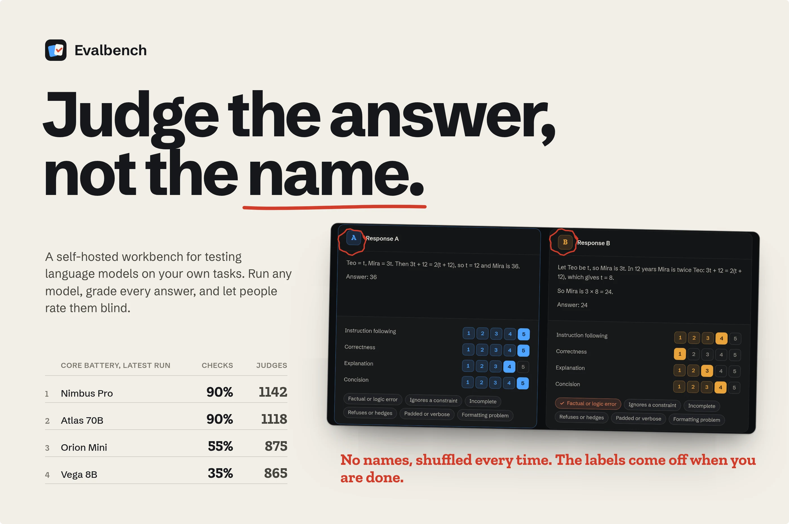
</picture>

<p align="center">
  <a href="#quickstart"><b>Quickstart</b></a>
  &nbsp;·&nbsp;
  <a href="#write-the-test-before-you-trust-the-model">Write a suite</a>
  &nbsp;·&nbsp;
  <a href="#judge-blind-the-way-training-teams-do">Blind judging</a>
  &nbsp;·&nbsp;
  <a href="#under-the-hood">How it works</a>
  &nbsp;·&nbsp;
  <a href="#quality">Tests</a>
  &nbsp;·&nbsp;
  <a href="https://gallowforge.github.io">More projects</a>
</p>

<p align="center">
  <a href="https://github.com/gallowforge/evalbench/actions/workflows/ci.yml"></a>
  
  
  
  
</p>

<br />

Picking a model by vibes is easy and wrong. A few chats feel convincing, a leaderboard measured someone else's tasks, and the next model update quietly breaks the one prompt your product depends on. Doing it properly means a spreadsheet of prompts, a script per provider, answers pasted side by side, and ratings nobody can trust because the rater knew which model wrote what.

**Evalbench is a self-hosted workbench for evaluating language models on your own tasks.** Write tasks and rubrics in YAML or in the browser, run them against local models in LM Studio or Ollama and API models from Anthropic and OpenAI, grade every answer with automatic checks, rate pairs of answers blind, and watch both scores move from run to run. It runs from one compose file, keeps everything in a single SQLite file, and never stores an API key.

<picture>
  <source media="(max-width: 700px)" srcset="docs/readme/numbers-mobile.webp" />
  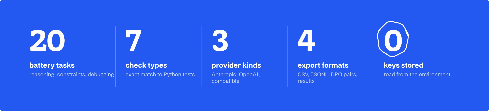
</picture>

<br />

## Know what happened before you scroll

The overview opens on a headline written from your latest run: who leads, by how much, what the judges think, and what broke since last time. Under it, a scorecard of every model with its pass rate, judge rating, trend and speed.

<picture>
  <source media="(max-width: 700px)" srcset="docs/readme/overview-mobile.webp" />
  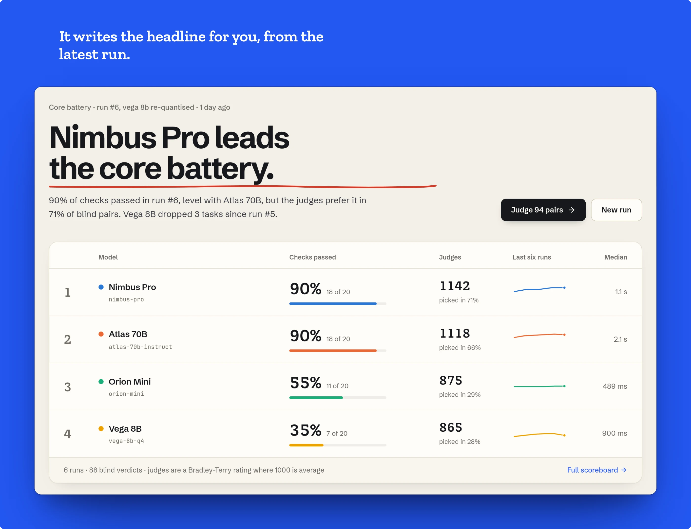
</picture>

## Write the test before you trust the model

A suite is a list of tasks. Each task has a prompt, optional reference answer for raters, and any number of automatic checks. Keep suites as YAML in git, or edit them in the browser: the form and the YAML are the same document, validated on every keystroke with errors that point at the exact field.

- **Seven check types.** Exact answer (numbers compare by value, so `4.50 hours` matches `4.5`), contains, avoids, regular expression, length in words, characters, lines or sentences, JSON with required keys and values, and Python tests that run the answer's code in the sandbox.
- **Grade the part that matters.** Each check can read the whole answer, the last line, an `Answer:` line, the first code block or the first JSON value. Reasoning blocks that some local models print (`<think>…</think>`) are removed first.
- **Rubrics for people.** Each suite defines the dimensions raters score from 1 to 5, such as instruction following, correctness and concision. A task can override them.

<picture>
  <source media="(max-width: 700px)" srcset="docs/readme/write-mobile.webp" />
  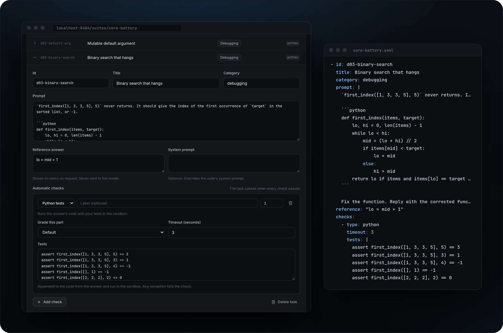
</picture>

## Run every model on the same tasks

Add a model in a few seconds: pick LM Studio, Ollama, Anthropic, OpenAI or any OpenAI-compatible server, find its model ids with one click, and test the connection without spending a token. Start a run and answers are graded the moment they arrive.

- **Keys stay in the environment.** A model stores the *name* of its key variable, such as `ANTHROPIC_API_KEY`. The value is read when a request is made and is never written to the database, the logs or an export.
- **Fair to slow hardware.** Each model has its own parallel limit, so a local model on one GPU runs one request at a time while API models run several, under one global cap.
- **History that cannot drift.** A run freezes the suite text and every model's settings when it starts. Edit a task tomorrow and last week's results still mean what they meant.

<picture>
  <source media="(max-width: 700px)" srcset="docs/readme/run-mobile.webp" />
  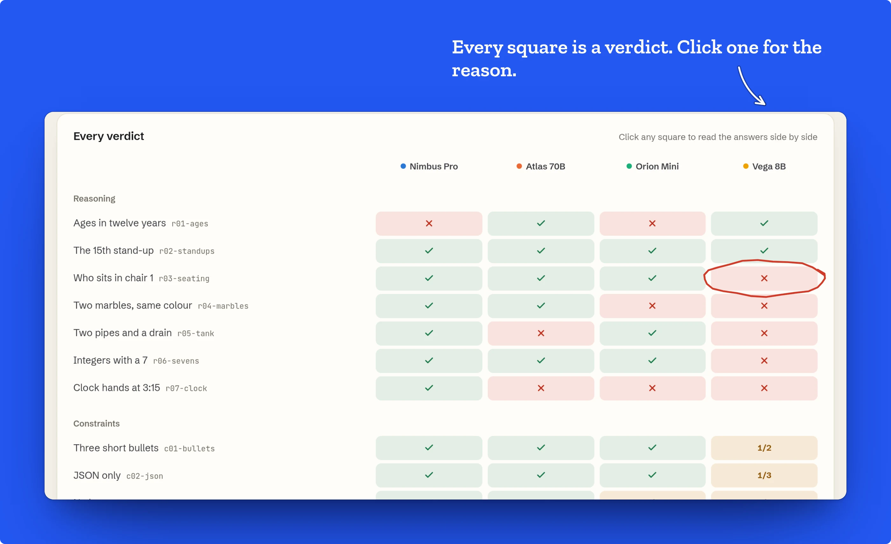
</picture>

## Read the answers side by side

Click any cell and every model's answer to that task opens in columns, with each check's verdict and the reason for it: `3 sentences (max 2)`, `AssertionError: the caller's list was modified`, `expected "36", got "24"`. Answers render as Markdown with highlighted code, or as raw text.

<picture>
  <source media="(max-width: 700px)" srcset="docs/readme/compare-mobile.webp" />
  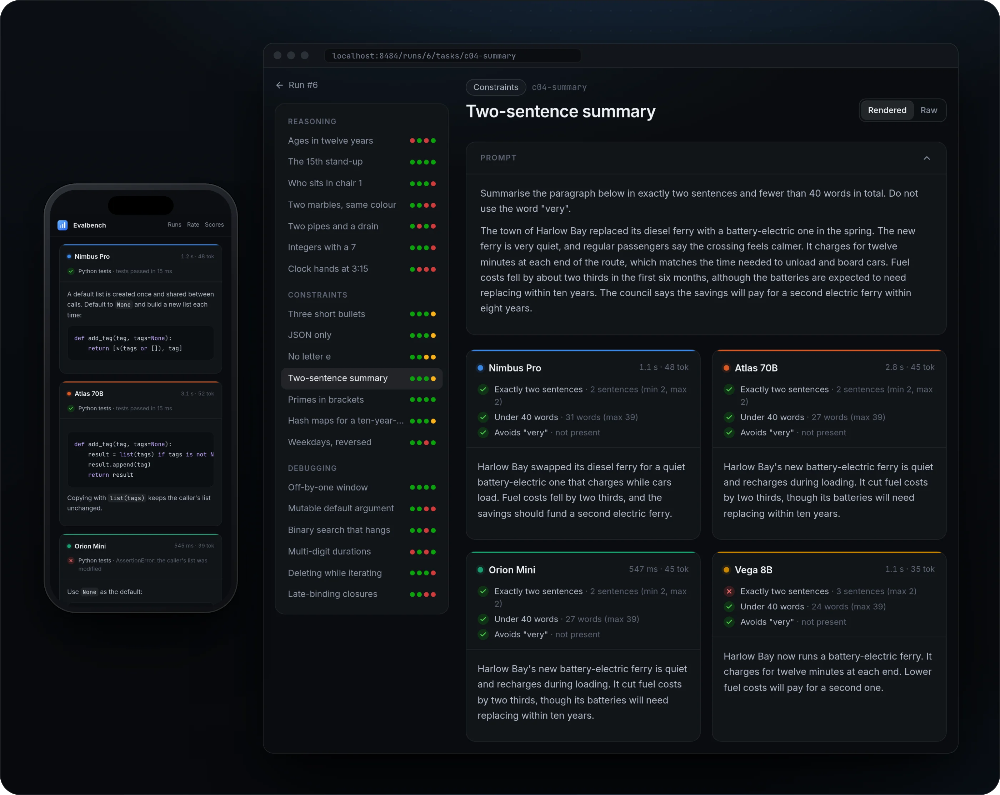
</picture>

## Judge blind, the way training teams do

Automatic checks catch wrong answers; people catch the rest. Evalbench deals two answers to the same task from two different models, like tasting cards turned face up: random order, nothing that names either model.

- **The questions rating platforms ask.** Score each response from 1 to 5 on every rubric dimension, tick issues such as a factual error or an ignored constraint, choose a side on a seven-point scale from "A is much better" to "B is much better", and write a justification. Confidence and time spent are recorded too.
- **A queue that stays balanced.** The next pair is always the least-rated one, so every pair of models gets coverage. Each rater has their own queue, and skipped pairs come back last.
- **Fast with a keyboard.** Keys `1` to `7` choose, `S` skips, `Ctrl`+`Enter` submits.
- **The labels come off at the end.** When your queue is done, the cards turn over: every pair you judged shows who wrote what, with a tally of which model you kept picking. Never before, so it can never sway a verdict.

<picture>
  <source media="(max-width: 700px)" srcset="docs/readme/rate-mobile.webp" />
  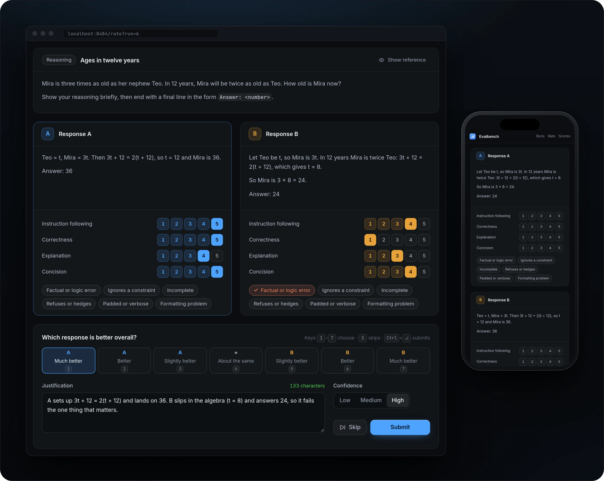
</picture>

## One leaderboard for checks and people

The scoreboard puts the two kinds of evidence next to each other: how many tasks each model passes, and how often people prefer its answers.

- **A rating you can trust.** Preferences are fitted with a Bradley-Terry model and shown on an Elo-like scale with a 95% bootstrap interval, so a lead inside the noise looks like one.
- **Where each model is strong.** Pass rates by category, win rates head to head, median latency and output tokens.
- **Every run on one chart.** Pass rate per model across runs, with the run label on hover.

<picture>
  <source media="(max-width: 700px)" srcset="docs/readme/scoreboard-mobile.webp" />
  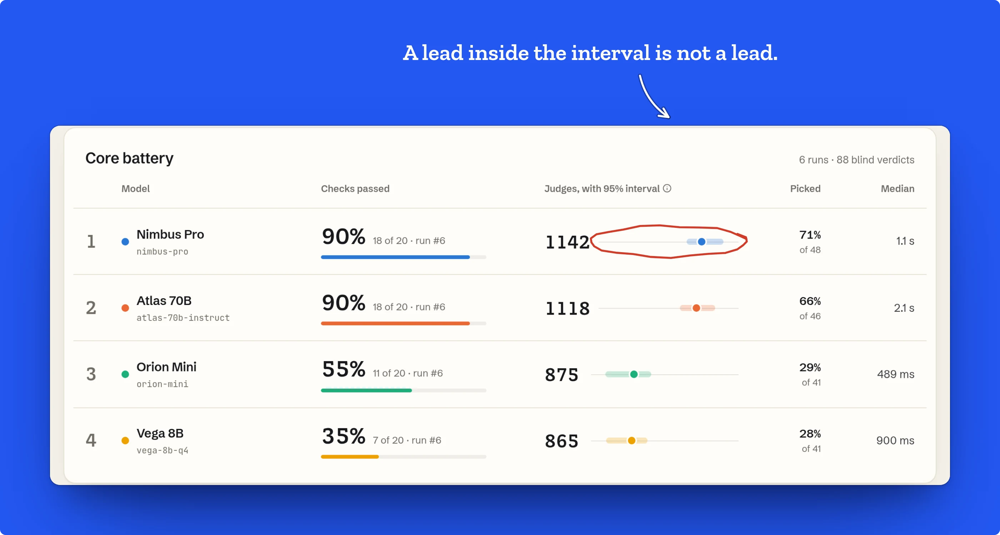
</picture>

## Catch a regression the day it lands

For each model, Evalbench compares its latest run with the one before and lists every task that now fails or now passes. If the task itself was edited between the runs, the change is marked as an edit, not blamed on the model.

<picture>
  <source media="(max-width: 700px)" srcset="docs/readme/history-mobile.webp" />
  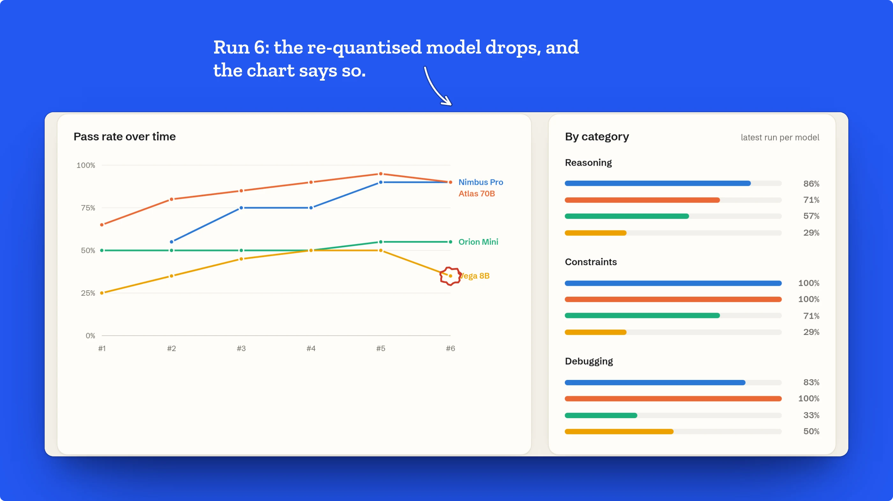
</picture>

The same check runs in CI. `evalbench run` sends a suite to one or more models headless and exits non-zero below a pass rate, so a prompt change or a new quantisation can fail a pull request:

```bash
evalbench run suites/support.yaml \
  --model anthropic:claude-haiku-5-5 \
  --model openai-compatible:qwen3-8b@http://localhost:1234/v1 \
  --fail-under 0.85 --ephemeral --allow-local-code
```

`--allow-local-code` lets Python checks run on the CI machine, which is fine for a throwaway runner; without it, and without a sandbox service, they are recorded as errors.

<picture>
  <source media="(max-width: 700px)" srcset="docs/readme/regressions-mobile.webp" />
  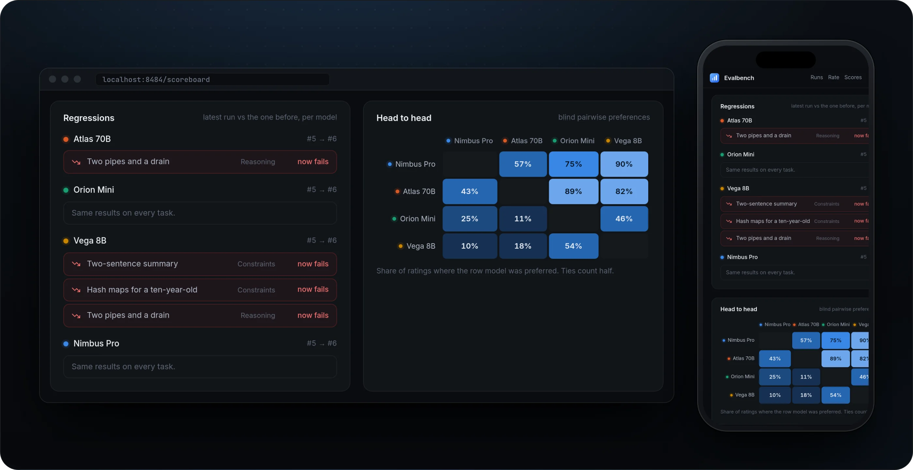
</picture>

## Take your data with you

Everything raters and checks produce downloads in one click, and every record carries the prompt and both answers, so a file stands on its own.

- **Ratings** as CSV (one row per rating, a column per rubric score) or JSONL.
- **Preference pairs** as `{prompt, chosen, rejected}` JSONL from every decisive rating, ready for DPO-style training. Ties are left out.
- **Run results** with every check verdict, score, latency and token count.

<picture>
  <source media="(max-width: 700px)" srcset="docs/readme/data-mobile.webp" />
  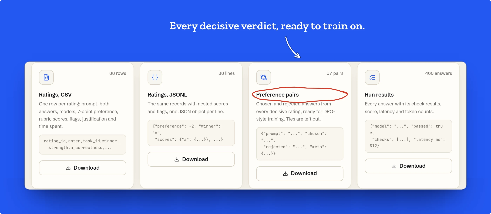
</picture>

## The core battery

Evalbench ships with a 20-task suite that separates careful models from fluent ones. Every task has one right answer or a hard constraint, and every one is graded automatically.

| Category | Tasks | What it tests | Graded by |
| --- | --- | --- | --- |
| Reasoning | 7 | Ages, a recurring meeting, a seating puzzle, probability, rates, counting, clock angles | The `Answer:` line, compared by value |
| Constraints | 7 | Exact bullet format, JSON only, a lipogram, a word-limited summary, banned words, ordering and case | Patterns, lengths, JSON and banned phrases |
| Debugging | 6 | Off-by-one, mutable defaults, a hanging binary search, parsing, mutating while iterating, late binding | Python tests in the sandbox, or the exact printed output |

`examples/suite-template.yaml` uses every field and every check type, with a comment on each.

## Why it is different

|                    | Evalbench                                  | A notebook and a spreadsheet | Hosted eval platforms     |
| ------------------ | ------------------------------------------ | ---------------------------- | ------------------------- |
| Where it runs      | Your machine, one compose file             | Your machine                 | Their cloud               |
| Local models       | LM Studio, Ollama, any compatible server   | If you write the client      | Often not                 |
| Human rating       | Blind, shuffled, rubric and justification  | Rater sees the model         | Usually, at a price       |
| Code checks        | Sandboxed container, no network            | Runs in your shell           | Varies                    |
| History            | Every run frozen, regressions per model    | Overwritten cells            | Yes                       |
| Your data          | One SQLite file, open exports              | Scattered files              | On their servers          |
| API keys           | Environment only, never stored             | Pasted into code             | Uploaded to the platform  |

## Quickstart

```bash
curl -O https://raw.githubusercontent.com/gallowforge/evalbench/main/compose.yaml
docker compose up -d
```

Open **http://localhost:8484** and create a password: Evalbench can spend API credits and run model-written code, so sign-in is on from the first visit. To look around before connecting a model, choose **Load the demo workspace**.

To use API models, put the keys in a `.env` file next to `compose.yaml` (see [`.env.example`](.env.example)) and run `docker compose up -d` again. To use LM Studio or Ollama on the same machine, add a model with the base URL `http://host.docker.internal:1234/v1` or `http://host.docker.internal:11434/v1`; compose already maps that name to the host.

The port is bound to this machine only. To open Evalbench to your network, change `127.0.0.1:8484:8484` to `8484:8484` in `compose.yaml`; sign-in stays on.

The image is published for `linux/amd64` and `linux/arm64`, so it runs on a Raspberry Pi as well.

<details>
<summary><b>Without Docker</b></summary>
<br />

```bash
git clone https://github.com/gallowforge/evalbench && cd evalbench
npm --prefix web ci && npm --prefix web run build
pip install .
evalbench serve            # http://localhost:8484, data in ./data
```

Without the sandbox container there is nowhere safe to run model-written code, so Python checks are recorded as errors (an error, not a failure, and resuming the run grades them later). Set `EVALBENCH_SANDBOX=local` to run them in a child process on this machine with the same CPU, memory, file and process limits, but with this machine's network and files. Use the compose setup for code from models you do not trust.

</details>

<details>
<summary><b>Configuration</b></summary>
<br />

| Variable | Default | Does |
| --- | --- | --- |
| `EVALBENCH_DATA` | `./data` (`/data` in Docker) | Where the SQLite file lives |
| `EVALBENCH_PORT` | `8484` | Port to listen on |
| `EVALBENCH_PASSWORD` | unset | Use this password instead of creating one in the browser |
| `EVALBENCH_AUTH` | on | `off` disables sign-in; Evalbench then accepts only requests addressed to localhost |
| `EVALBENCH_ALLOWED_HOSTS` | unset | Extra host names to accept while sign-in is off |
| `EVALBENCH_SANDBOX_URL` | unset (`http://sandbox:8485` in compose) | Run Python checks in the sandbox service |
| `EVALBENCH_SANDBOX` | unset | `local` runs Python checks on this machine when there is no sandbox service |
| `EVALBENCH_CONCURRENCY` | `8` | Requests in flight across all models |
| `EVALBENCH_MIN_JUSTIFICATION` | `30` | Characters a rating justification needs |
| `EVALBENCH_DEMO` | unset | Load the demo workspace on first start |
| `ANTHROPIC_API_KEY`, `OPENAI_API_KEY` | unset | Read at call time and sent only to Anthropic's and OpenAI's own APIs; other endpoints name their own variable ending in `_API_KEY` or `_TOKEN` |

</details>

<br />

## Under the hood

<details>
<summary><b>How a run works</b></summary>
<br />

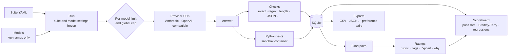

| Question | Method |
| --- | --- |
| Task score | Weighted share of checks passed; a task passes only when every check passes. Tasks without checks are left to human rating. |
| Pass rate | Passed tasks over graded tasks, where an answer that errored (a timeout, a rate limit) counts as not passed, so a model that keeps failing to answer cannot look perfect. |
| Exact answers | Trimmed, spaces collapsed, case ignored unless asked; a numeric expectation also matches an answer that contains exactly one number, so `4.50 hours` counts and `3 + 4 = 7` does not. |
| Which answers form a pair | Two models' answers to the same version of the same task, in one run or each model's latest answer across runs. Identical answers are skipped. |
| Which pair comes next | The least-rated pair, then the least-rated pair of models, ties broken at random; sides are shuffled. |
| Human rating | Bradley-Terry strengths by minorise-maximise (Hunter, 2004), with one virtual draw per model against a fixed reference so unbeaten models stay finite. Reported as 1000 + 400·log10 of strength over the geometric mean. |
| Confidence interval | 200 bootstrap resamples of the ratings, 2.5th to 97.5th percentile. |
| Win rate | Ratings where the model was preferred, ties counting half. |
| Regression | A task that passed in a model's previous run and fails in its latest. A changed task fingerprint (prompt, system prompt and checks) marks it as an edit instead. |
| Refusals | Recorded as the model's answer with its stop reason. No fallback model is ever substituted, because a run measures the model that was asked. |

</details>

<details>
<summary><b>Security model</b></summary>
<br />

**Keys.** Models store the name of an environment variable, never its value. The value is read per request, held only by the SDK client, and never returned by the API, written to SQLite, logged or exported. A key can only go where it belongs: `ANTHROPIC_API_KEY` and `OPENAI_API_KEY` are sent only to Anthropic's and OpenAI's own APIs, so no model setting can point them at another server; any other endpoint uses its own variable ending in `_API_KEY` or `_TOKEN`, and `EVALBENCH_` settings are never accepted as keys. The server process is marked non-dumpable, so other processes of the same user cannot read its environment.

**Access.** Sign-in is on by default. The password comes from `EVALBENCH_PASSWORD` or is created in the browser on first visit and stored as a scrypt hash. Sessions are signed, HTTP-only cookies tied to the current password, so changing it signs everyone out, and five failed attempts a minute pause further tries. With sign-in turned off, only requests addressed to localhost are served, which also stops DNS-rebinding pages. Compose binds the port to this machine unless you change it.

**Model-written code.** Python checks run in a separate container from the same image, with layers that each stop a different escape:

| Layer | Setting |
| --- | --- |
| Network | An internal Docker network with no route to the internet or your LAN, and the app refuses every request that comes from the sandbox |
| Filesystem | Read-only root, a 64 MB `tmpfs` for work directories, no access to the data volume |
| Users | Each concurrent execution runs as its own unprivileged user, so it cannot signal the service or read another run's files; the service keeps only the capabilities needed to switch users |
| Resources | 768 MB memory, one CPU, 64 processes for the container |
| Each execution | Fresh directory, empty environment, isolated Python, CPU, memory, file size and open-file limits, output capped on disk, and a process limit of zero, so it cannot fork |
| Grading | The answer runs inside `exec`, so a stray `sys.exit()` cannot skip the tests, and a per-run marker printed after the tests proves they all ran |

CI checks the network layer, the app's refusal and the per-run users on every push. It is a strong container setup, not a virtual machine: run it on a host you would trust with a container. Without the sandbox service, Python checks are not run at all unless you opt in with `EVALBENCH_SANDBOX=local`.

**Rendering.** Model output is untrusted text: it is rendered as sanitised Markdown with no scripts, styles, forms, frames or remote images (images become links), and only syntax-highlighting classes survive, so an answer cannot restyle or cover the rating controls. CSV exports neutralise cells that a spreadsheet would run as formulas.

</details>

<details>
<summary><b>Quality bar</b></summary>
<br />

<a id="quality"></a>

| Check | What it covers |
| --- | --- |
| 86 Python tests | Suite parsing and error messages, every check type, the sandbox limits (no fork, no processes, memory and output caps, empty environment, timeouts), early-exit tricks that must not pass, Bradley-Terry and bootstrap maths, pair blindness and balance, rating validation and duplicates, the API end to end through the real Anthropic and OpenAI SDKs against a local fake server, keys that cannot be redirected, first-run password setup and throttling, localhost-only mode, runs without a sandbox, provider errors, exports and the CLI gate. |
| Battery consistency | Every scripted demo answer is graded by the real engine: strong answers must pass every check and weak ones must fail one, which keeps the suite, the checks and the demo honest with each other. |
| 5 end-to-end tests | Playwright against the built app: the overview, the result matrix and side-by-side answers, a complete blind rating with no model name on screen, editing a task in the form and reading it back as YAML, and the exports. |
| 6 web unit tests | Formatting of rates, durations and relative times, and the sanitiser: highlighted code survives, remote images, scripts, styles, forms and borrowed layout classes do not. |
| Docker in CI | Builds the image, starts the compose stack, signs in, loads the demo through the sandbox container, and proves the sandbox has no route out, is refused by the app and runs each execution as its own user. |
| Lint and format | Ruff for Python; TypeScript strict mode and Prettier for the web app. |

</details>

<details>
<summary><b>Stack and architecture</b></summary>
<br />

Python 3.12+ with [FastAPI](https://fastapi.tiangolo.com), SQLite in WAL mode, Pydantic, and the official [Anthropic](https://github.com/anthropics/anthropic-sdk-python) and [OpenAI](https://github.com/openai/openai-python) SDKs. The web app is React 19 with TypeScript, Vite, Tailwind CSS v4, TanStack Query and CodeMirror. Type is Schibsted Grotesk, with Zilla Slab for scores and JetBrains Mono for code, all bundled, so no request leaves for fonts.

```
evalbench/
  suites.py       the suite format: tasks, checks, rubrics, validation, YAML round trip
  checks.py       answer extraction and the seven check types
  sandbox/        resource-limited Python execution, and the sandbox HTTP service
  providers.py    Anthropic, OpenAI and OpenAI-compatible clients; keys from the environment
  runner.py       runs: snapshots, per-model limits, grading, cancel and resume
  ratings.py      blind pairs, rating validation, Bradley-Terry and bootstrap
  stats.py        run summaries, scoreboard, history and regressions
  export.py       CSV, JSONL and preference-pair exports
  app.py          the HTTP API, password gate and the web app
  data/           the core battery and the scripted demo answers
web/src/          the React app: overview, suites, models, runs, compare, rate, scoreboard, data
web/e2e/          Playwright tests
web/scripts/      the generator for the images in this README
```

</details>

<details>
<summary><b>Run it locally</b></summary>
<br />

```bash
python -m venv .venv && .venv/bin/pip install -e ".[dev]"
npm --prefix web ci
.venv/bin/evalbench serve &          # API on :8484
npm --prefix web run dev             # web app on :5173, proxied to the API
.venv/bin/pytest                     # Python tests
npm --prefix web test                # web unit tests
npm --prefix web run build && PATH=.venv/bin:$PATH npm --prefix web run e2e
```

The images in this README come from `npm --prefix web run readme:visuals`, which captures the running app on the demo workspace at desktop and phone sizes and composes each scene.

</details>

## FAQ

<details>
<summary><b>Are the screenshots real?</b></summary>
<br />
Yes. They are captures of the app running the bundled demo workspace. The four demo models (Nimbus Pro, Atlas 70B, Orion Mini, Vega 8B) are fictional and their answers are scripted, but every check result, pass rate, rating and regression in the images is computed by the same code that grades real runs.
</details>

<details>
<summary><b>Does anything leave my machine?</b></summary>
<br />
Only the prompts you send to the models you configure. There is no telemetry, no account and no external font or script request. Local models never leave your network.
</details>

<details>
<summary><b>Why Bradley-Terry and not Elo?</b></summary>
<br />
Elo depends on the order ratings arrive in, so the same ratings shuffled give different scores. Bradley-Terry fits all ratings at once, gives the same answer for any order, and comes with a proper confidence interval from the bootstrap.
</details>

<details>
<summary><b>Can several people rate?</b></summary>
<br />
Yes. Everyone signs in with the install's password, sets a rater name in their browser, and gets their own queue of unrated pairs; every rating records who made it, and nobody can rate the same pair twice.
</details>

<details>
<summary><b>Which models work?</b></summary>
<br />
Anthropic and OpenAI models through their official SDKs, and anything that speaks the OpenAI chat-completions API: LM Studio, Ollama, vLLM, llama.cpp's server and most hosted gateways. Temperature applies to OpenAI-compatible models; effort applies to Anthropic and OpenAI reasoning models.
</details>

<details>
<summary><b>Is it safe to run code a model wrote?</b></summary>
<br />
In the compose setup the code runs in a container with no route out, a read-only filesystem, its own unprivileged user per execution and hard resource limits, it cannot start another process, and the app refuses to talk to it. That stops the realistic failure modes: infinite loops, memory and output bombs, fork bombs, file writes, calls home and tricks that skip the tests. It is not a virtual machine, so do not point it at code from an attacker who targets container escapes.
</details>

## Contributing

Issues and pull requests are welcome. Run `pytest`, `ruff check evalbench tests`, `npm --prefix web run typecheck` and `npm --prefix web test` before opening one; CI also runs the end-to-end suite and the Docker checks. New check types belong in `evalbench/checks.py` with tests beside the existing ones.

## Licence

[MIT](LICENSE).
